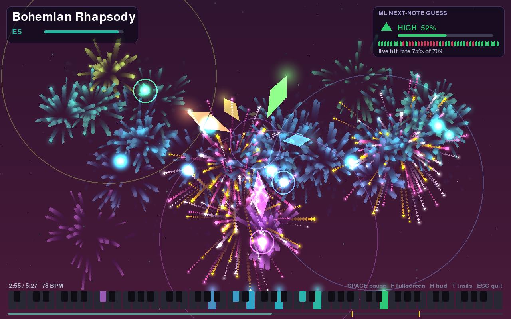

# 👑 Bohemian Rhapsody Music Visualiser

A MIDI-driven music visualiser inspired by Queen's "Bohemian Rhapsody", featuring glowing geometric particle bursts, a rotating chroma wheel, a live piano roll, drum-driven pulses, sparkle effects for dramatic moments, and a completely pointless but fun ML model that predicts whether the next note will be high or low (and keeps score)!



> **Note**: This repository contains only the visualizer code. You must provide your own MIDI and audio files. The code itself is open source, but please respect copyright laws when obtaining music files.

## Features

✨ **Reactive Visualisation**

- Glowing geometric bursts (circles, squares, triangles) with motion trails
- Colour follows pitch on a gradient: purple (low) → teal → green → gold (very high)
- Particle count, size and speed scale with note velocity; pitch sets vertical position
- Loud notes send out shockwave rings

✨ **Musical Read-outs**

- **Chroma wheel**: 12 petals, one per pitch class, growing with what's being played. It spins faster as the song gets busier
- **Piano roll**: an 88-key keyboard lights up every note currently sounding
- **Mood background**: shifts from deep indigo to magenta as overall intensity rises
- **Progress bar** with gold markers at tempo changes, plus live BPM

✨ **Drums Drive the Stage**

- Kick drum pulses the centre glow, the wheel and the starfield
- Snare fires a full-screen shockwave
- Cymbals scatter star dust

✨ **Dramatic Moments**

- Loud notes during high-intensity passages trigger sparkle explosions, a screen flash and camera shake (at most every 15 seconds)

✨ **ML Prediction** (The Fun Part!)

- Random Forest classifier trained on the melodic notes
- Predicts if the next note will be HIGH or LOW, with a confidence gauge
- Scores itself live: a strip of green/red ticks for recent hits and misses, plus a running hit rate
- Completely unnecessary but delightful!

## Installation

```bash
pip install -r requirements.txt
```

## Getting Files

### MIDI File (Required for visualisation)

You'll need a MIDI version of "Bohemian Rhapsody". You can find MIDI files on:

- [MuseScore](https://musescore.com) - Search for "Bohemian Rhapsody Queen"
- [MidiWorld](https://www.midiworld.com)
- [BitMidi](https://bitmidi.com)

Save the file as `Queen - Bohemian Rhapsody.mid` in this directory.

### Audio File (Optional but recommended for sound)

For audio playback, add an MP3 file:

- Download or convert "Bohemian Rhapsody" to MP3 format
- Save as `bohemian_rhapsody.mp3` in this directory
- The visualiser will automatically detect and play it

**Note**: MIDI audio playback on Windows often doesn't work without additional drivers. Using an MP3 file is the easiest way to hear the music.

## Usage

```bash
# With default filename (Queen - Bohemian Rhapsody.mid)
python bohemian_rhapsody_visualizer.py

# With custom MIDI file
python bohemian_rhapsody_visualizer.py path/to/your/midi/file.mid
```

## Controls

- **SPACE**: Pause/Resume
- **F**: Toggle fullscreen
- **H**: Hide/show the HUD
- **T**: Toggle motion trails
- **ESC**: Exit

## How It Works

### MIDI Parsing

Uses `mido` library to parse MIDI files and extract:

- Note start and end times in seconds, honouring every tempo change in order
- Note pitch (0-127) and velocity (intensity)
- Channel (channel 10 is treated as drums, not pitches)
- Tempo changes, shown on the progress bar

### Visualisation

Rendering is layered, back to front:

1. Mood gradient (pre-rendered at 16 intensity levels) and kick-drum glow
2. Parallax starfield
3. Trail layer: particle cores, faded each frame rather than cleared
4. Glow layer: cached radial glow sprites, shockwaves and the chroma wheel, blended additively
5. Piano roll and HUD

Glow sprites are generated once with numpy and reused, and trail fading uses surface blits (SDL's fast path) rather than blended fills, which keeps a busy frame well inside the 60 FPS budget.

### Sparkle Effects

Triggered when:

- A melodic note's velocity exceeds 80%
- Overall intensity (velocity-weighted notes per second) is in roughly the top 10% for the song
- At least 15 seconds since the last one
- Creates white/gold/pink explosions, a screen flash and a short camera shake

### ML Note Prediction

1. **Training**: Analyses the melodic notes (drums excluded)
2. **Features**: Last 5 notes + their velocities (10 features)
3. **Label**: Next note is HIGH (at or above median) or LOW (below median)
4. **Model**: Random Forest with 50 trees
5. **Evaluation**: Trained on the first 80% of the song, tested on the last 20% (unshuffled, so overlapping note windows can't leak into the test set)
6. **Prediction**: Updates on every new melodic note, and is checked against the note that actually arrives

Expect around 65% held-out accuracy. The live hit rate during playback runs higher (75-80%) because most of the song was in the training data, so treat it as entertainment rather than evidence.

## Code Structure

```
bohemian_rhapsody_visualizer.py
├── GlowCache           # Pre-rendered additive glow sprites
├── NotePredictor       # ML model for note prediction
├── Particle            # Glowing geometric particle
├── Sparkle             # Dramatic moment sparkle effect
├── Shockwave           # Expanding ring for loud notes and snares
├── Star                # Background starfield
└── BohemianRhapsodyVisualizer  # Main visualiser class
    ├── _parse_midi     # Tempo-aware note timing and durations
    ├── update          # Note triggering, drums, ML scoring, decay
    ├── draw            # Layered rendering
    └── run             # Event loop and audio
```

## Technical Details

- **Frame rate**: 60 FPS
- **Resolution**: 1280x800, scaled to fit when fullscreen
- **Particle lifetime**: ~0.7 seconds (sparkles ~1.7 seconds), capped at 2,500 live particles
- **ML sequence length**: 5 notes
- **Physics**: Simple gravity (200 px/s²) with light drag

## Why the ML Model?

Because we can! The model learns patterns in the melody and tries to predict pitch direction. While not useful for visualisation, it's entertaining to see the AI "anticipate" the music. Sometimes it gets the dramatic moments right, which feels magical.

## Customisation Ideas

- Change the pitch gradient in `pitch_colour()` or the wheel colours in `pitch_class_colour()`
- Modify `key_change_threshold` and `dramatic_energy` for more/fewer sparkles
- Adjust `trail_fade` for longer or shorter trails
- Change ML `sequence_length` for different prediction windows
- Map other drum notes in `handle_drum()`
- Label the song's sections on the progress bar

## Requirements

- Python 3.9+
- pygame 2.5+
- mido 1.3+
- numpy 1.24+
- scikit-learn 1.3+

Minimum versions rather than exact pins, so current wheels install on newer Python releases. Tested with pygame 2.6.1, mido 1.3.3, numpy 2.5.3 and scikit-learn 1.9.1 on Python 3.13.

## License

MIT License - Free to use, modify, and rock out with! 🎵

**Important Copyright Notice**: 
- The visualizer code is open source under MIT License
- "Bohemian Rhapsody" is copyrighted by Queen/EMI
- Users must obtain their own legal copies of MIDI and audio files
- Do not distribute copyrighted music files with this code

---

*"Is this the real life? Is this just fantasy?"* - Now with ML!
